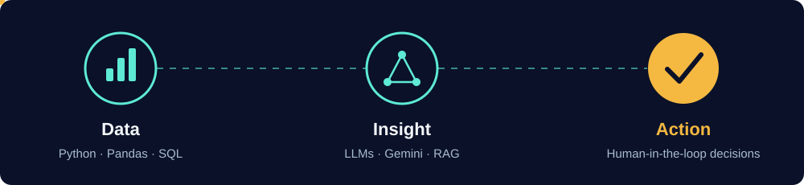

 

---

## 👋 About me

I'm a **B.Tech AI & Data Science** student at CGC Jhanjeri (CGPA **9.78**) who builds AI products that solve real problems, from tools for India's gig workers to decision-support systems for education.

I like systems where **AI helps people decide better instead of replacing them**: deterministic code for the numbers, an LLM for reasoning, and a human for the final call.

| | |
|---|---|
| 🔭 **Building** | GenAI apps with Next.js, FastAPI and the Gemini API |
| 🌱 **Learning** | AI agents (Google ADK), RAG, MCP, production-grade GenAI, DSA |
| 🏗️ **Founder** | [BuildNest](https://linkedin.com/in/harjotsingh97801), a student tech community for builders and hackathon teams |
| 🏆 **Recently** | SIH 2026 next round · PromptWars Chandigarh 93.1/100 · ECSOC '26 |
| 💬 **Ask me about** | Building with LLMs, hackathons, student communities, open source |
| 📫 **Reach me** | harjotsinghpb0008@gmail.com |

---

## ⚙️ How I build

  

> **Python handles the math. The LLM handles reasoning. Humans make the decision.**
> That separation keeps AI outputs explainable and prevents treating a language model as a source of numerical truth.

---

## 🚀 Flagship projects

### 🧭 Saarthi AI (Gig Sahayak) — multilingual AI companion for gig workers
Helps delivery partners, drivers and daily-wage workers with **earnings and fuel calculation, payout-document review, grievance drafting, safety guidance and welfare-scheme information** in **English, Hindi and Punjabi**.
Calculations run locally; Gemini powers chat and document analysis. Scored **93.1/100** at *BuildWithAI: PromptWars Chandigarh*.

`Next.js` `TypeScript` `Tailwind CSS` `Gemini API`
🔗 [Live demo](https://lnkd.in/dtiCxBc8) · 💻 [Source code](https://github.com/Harjotsingh00/gig-worker-companion)

### 📊 ShikshaPulse AI — education intelligence & action platform
Moves education data from **dashboard to decision**: school- and block-level analysis, priority-gap identification, a local AI copilot, action plans with owner and deadline tracking, and an evidence-to-action trace, all with a human-in-the-loop workflow. *(Runs on synthetic demo data.)*

`React` `Vite` `FastAPI` `Pandas` `SQLite` `Ollama` `Recharts`
📖 [Read the write-up](https://lnkd.in/dNEGQ-7w) · 💻 [Source code](https://lnkd.in/dDiNvkGX)

---

## 🧪 More projects

Also built: RailGuard AI, CodeVibe AI, SentinelAI, RecruitMind-AI, ReliefOS, CarbonLens.

---

## 🧰 Tech stack

 
 
 

**GenAI:** Google Gemini API · Ollama (local LLMs) · Prompt Engineering · RAG concepts · Google ADK *(learning)*

---

## 🏅 Achievements

| | Highlight |
|---|---|
| 🇮🇳 **Smart India Hackathon 2026** | Team Alphonics selected for the next round after the internal round at CGC University |
| 🥇 **BuildWithAI: PromptWars** | Scored **93.1/100** with Saarthi AI (Gig Sahayak) |
| 🌍 **Elite Coders Summer of Code '26** | Open-source programme participant |
| ☁️ **Google Cloud Gen AI Academy (APAC)** | Completed via Hack2skill |
| 🎓 **Google AI Educator Series** | Multiple badges earned |
| 🏗️ **BuildNest** | Founded a student builder community that started with 13 members |
| 📈 **YuvaIntern × NSDC** | Logistics Data Analyst Intern |

---

## 📈 GitHub activity

 

 

  

<picture>
  <source media="(prefers-color-scheme: dark)" srcset="https://raw.githubusercontent.com/Harjotsingh00/Harjotsingh00/output/github-snake-dark.svg" />
  <source media="(prefers-color-scheme: light)" srcset="https://raw.githubusercontent.com/Harjotsingh00/Harjotsingh00/output/github-snake.svg" />
  
</picture>

---

## 🤝 Let's connect

 

**Looking for an AI/ML or software engineering intern? Let's talk.**

